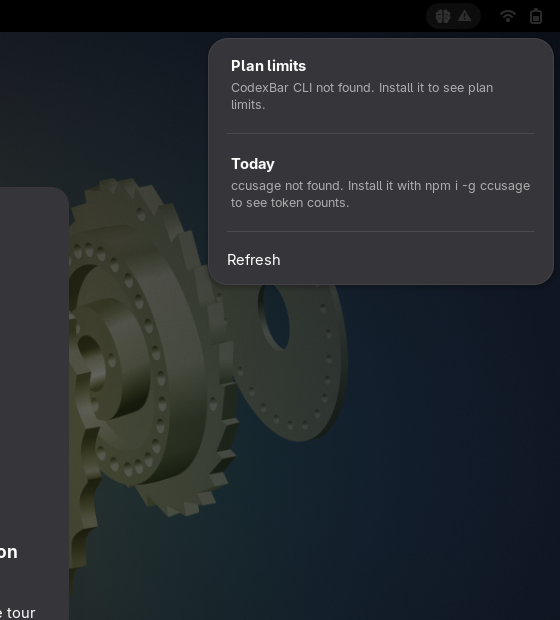

# Headroom

A GNOME Shell extension that shows how much of your AI plan you have left, right in the top bar. It also has a daily token counter, which you should mostly ignore ([see below](#a-note-on-tokenmaxing)).



## What it shows

**In the top bar:** a brain icon, the percentage left in whichever plan window is closest to running out, and today's token count. The percentage turns yellow at 25% left and red at 10%.

**Plan limits** (from [CodexBar](https://github.com/steipete/CodexBar)):

- a bar for each rate-limit window your plan has (session, weekly, model-specific)
- a countdown to each reset
- your pace: whether you're on track to last until the reset

**Today** (from [ccusage](https://github.com/ryoppippi/ccusage)):

- tokens used and what they would have cost at API prices
- output, input and cache split, and a per-model breakdown
- a 7-day sparkline and your personal best day

The sparkline's bar heights are relative to the week's busiest day. The colour of each bar shows how close that day came to your all-time best, from blue through purple and orange to red.

## A note on tokenmaxing

The bottom half of this menu is a scoreboard for a game nobody should be playing.

Tokens are an input, not an output. A billion tokens spent going round in circles are worth less than one good idea you had in the shower. What matters is whether the work got better: the bug fixed, the feature shipped, the design that finally made sense. The token count says nothing about any of that. The "API-equivalent" cost isn't what you paid either. It's what the same tokens would have cost at pay-as-you-go prices, which mostly measures how much your cache got read.

All the same, we built a sparkline, coloured it from cool to hot, and added a personal best with a trophy for beating it. We know.

So use the top half to find out whether you'll make it to Friday. Treat the bottom half like a step counter: mildly interesting, occasionally motivating, and unrelated to whether you did anything worthwhile today.

## Requirements

- GNOME Shell 50 or 51.
- **The [CodexBar](https://github.com/steipete/CodexBar) CLI** for plan limits. It supports Claude, Codex, Gemini, Cursor, Copilot and many more. Linux builds are on its [releases page](https://github.com/steipete/CodexBar/releases), and it's also packaged for Homebrew (`steipete/tap/codexbar`) and the AUR (`codexbar-cli`). You only need the CLI, not the desktop app.
- **[ccusage](https://github.com/ryoppippi/ccusage)** for token counts: `npm i -g ccusage`. It reads your local Claude Code logs (plus the other agents it supports) and makes no network calls in the mode Headroom uses.

Either tool is optional. If one is missing, its half of the menu tells you how to install it.

## Install

```sh
git clone https://github.com/jasperblues/gnome-headroom.git \
  ~/.local/share/gnome-shell/extensions/headroom@jasperblues.github.io
glib-compile-schemas ~/.local/share/gnome-shell/extensions/headroom@jasperblues.github.io/schemas
```

Log out and back in (GNOME on Wayland only discovers new extensions at login), then:

```sh
gnome-extensions enable headroom@jasperblues.github.io
```

## Settings

There's no preferences window yet. Use `gsettings`:

```sh
schemas=~/.local/share/gnome-shell/extensions/headroom@jasperblues.github.io/schemas

# Which CodexBar provider's limits to show (default: claude). See `codexbar usage --help` for the full list.
gsettings --schemadir $schemas set org.gnome.shell.extensions.headroom provider codex

# Where the tools are, if Headroom can't find them itself (default: auto-detect)
gsettings --schemadir $schemas set org.gnome.shell.extensions.headroom codexbar-path /opt/codexbar/codexbar
gsettings --schemadir $schemas set org.gnome.shell.extensions.headroom ccusage-path ~/.npm-global/bin/ccusage
```

Changes apply immediately.

If you leave the paths empty, Headroom looks for `codexbar` on your PATH, in `~/.local/bin`, Linuxbrew, `/usr/local/bin` and `/usr/bin`. It looks for `ccusage` on your PATH, in `~/.local/bin`, bun and volta, and loads nvm if you use it. GNOME Shell doesn't run your shell profile, which is why it searches these places itself.

## How it works

Headroom never contacts AI providers itself. It runs the two tools and draws what they report:

- `codexbar usage --provider <provider> --json` every 5 minutes. CodexBar fetches your limits using the logins you already have (OAuth, CLI credentials and so on).
- `ccusage daily --json --offline` every 2 minutes. This only reads local log files.

Both also refresh when you open the menu, if their data is more than a minute old.

## Development

`tools/nested-shot.sh` starts the extension in a throwaway headless GNOME Shell and saves screenshots of the top bar and the open menu to `tools/out/`. Your own session and settings aren't affected. It needs `mutter-devkit`.

```sh
tools/nested-shot.sh          # your real data
tools/nested-shot.sh --demo   # fake data from tools/demo/ (used for the README screenshot)
```

## Credits

The plan-limit data comes from [CodexBar](https://github.com/steipete/CodexBar) by Peter Steinberger, which does the hard work of talking to over a hundred providers. The token data comes from [ccusage](https://github.com/ryoppippi/ccusage) by ryoppippi.

## License

MIT. See [LICENSE](LICENSE).
